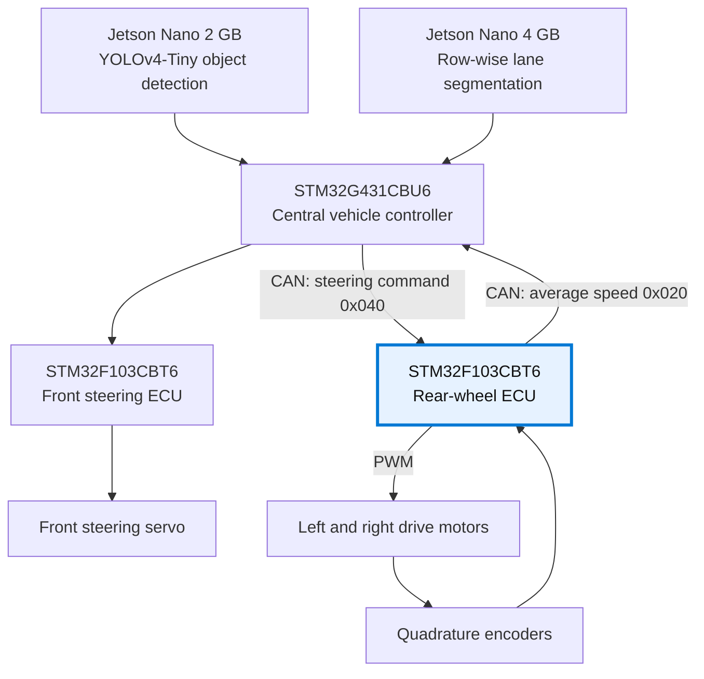

<h1 align="center">Rear-Wheel ECU · Autonomous Vehicle</h1>

<p align="center">
  Dual-motor speed control with STM32, FreeRTOS, and CAN.<br>
  Part of a student research vehicle combining embedded control and Jetson-based perception.
</p>

<p align="center">
  
  
  
  
  
</p>

<p align="center">
  <a href="vid_car.mp4">Watch the vehicle demo</a> ·
  <a href="#system-architecture">System architecture</a> ·
  <a href="#my-contribution">My contribution</a> ·
  <a href="#research-recognition">Research recognition</a>
</p>

<p align="center">
  
</p>

## Overview

This repository contains the **rear-wheel electronic control unit (ECU)** firmware for a student autonomous vehicle. The vehicle combines two NVIDIA Jetson boards for perception with three STM32 controllers for central coordination, steering, and rear-wheel actuation.

The rear ECU converts steering commands from the central controller into separate left and right wheel-speed targets. Quadrature encoders close the feedback loop, while CAN carries commands and vehicle-speed feedback between the controllers.

**Author / rear-wheel ECU contributor:** Bùi Đoàn Anh Khoa.

## My contribution

My responsibility in the team project is the **rear-wheel ECU**: controlling both drive motors and integrating their feedback with the vehicle controller. The implementation in this repository covers:

- Independent wheel-speed regulation using encoder feedback and PI control.
- A periodic 100 Hz motor-control task under FreeRTOS.
- Steering-dependent speed scheduling, acceleration/deceleration limiting, and a simple electronic differential.
- CAN command reception and average rear-wheel speed feedback.
- Command validation, command-loss handling, and periodic UART diagnostics.

The Jetson perception pipelines, central vehicle controller, and front-wheel steering ECU belong to the wider team system. Their source code is outside this repository.

## System architecture

| Module | Hardware | Responsibility |
| --- | --- | --- |
| Object detection | Jetson Nano 2 GB | YOLOv4-Tiny object detection |
| Lane detection | Jetson Nano 4 GB | Lane detection using row-wise segmentation |
| Central vehicle controller | STM32G431CBU6 mini core board | Central processing and coordination |
| Front-wheel ECU | STM32F103CBT6 | Steering-servo control |
| **Rear-wheel ECU — this repository** | **STM32F103CBT6** | **Dual drive-motor control and speed feedback** |

The diagram shows functional relationships; it does not specify the Jetson communication interfaces.



## Rear-wheel control

Every **10 ms**, the motor-control task reads encoder count changes, estimates and filters wheel speeds, updates speed references, and computes the motor PWM outputs.

| Feature | Current implementation |
| --- | --- |
| Feedback | TIM2/TIM3 quadrature encoders; configured 1,560 counts per wheel revolution |
| Wheel model | Configured wheel diameter: 65 mm |
| Speed filtering | First-order low-pass filter, α = 0.30 |
| Controller | Separate left/right PID structures; both derivative gains are zero, giving PI control |
| Anti-windup | Integral clamping and conditional integration |
| Speed scheduling | Steering-dependent base speed, 0.10–0.30 m/s |
| Reference limiting | Ramp up: 2.0 m/s²; ramp down: 4.0 m/s² |
| Differential | Steering-dependent left/right target offset; maximum ratio 0.10 |
| Motor output | TIM4, four PWM channels for two bidirectional motors |
| Command freshness | Configured 200 ms timeout; intended response is ramp-down followed by zero PWM |
| Telemetry | CAN speed feedback every 50 ms; UART diagnostics every 500 ms |

These values describe the firmware configuration. They are not measured performance results. The differential is a simple steering-based adjustment; it does not implement a geometry-based Ackermann model.

Four application tasks separate CAN reception, motor control, CAN transmission, and UART diagnostics. Application task storage and the receive queue use static allocation.

## CAN protocol

**Classic CAN · 500 kbit/s · standard 11-bit identifiers · little-endian payloads**

Directions below are relative to the rear-wheel ECU.

| Direction | Identifier | Payload | Unit | Timing |
| --- | --- | --- | --- | --- |
| RX from VCU | `0x040` | Signed 16-bit target steering angle | 0.01 degree | Must remain fresh within the configured 200 ms window |
| TX to VCU | `0x020` | Signed 16-bit average rear-wheel speed | mm/s | Every 50 ms |

The documented payload length is two bytes. The current receive parser accepts at least two bytes and validates the frame and angle before updating the command.

- Steering center: **90°**; accepted range: **50–130°**.
- Example command: **90° → 9000 → `28 23`**.
- Example feedback: **0.25 m/s → 250 mm/s → `FA 00`**.

## Hardware interface

Pin assignments below come from the current firmware configuration.

| Function | Peripheral | MCU pins |
| --- | --- | --- |
| Encoder input pair 1 | TIM2 CH1/CH2 | PA0 / PA1 |
| Encoder input pair 2 | TIM3 CH1/CH2 | PA6 / PA7 |
| Motor PWM outputs | TIM4 CH1–CH4 | PB6 / PB7 / PB8 / PB9 |
| CAN RX / TX | CAN1 | PA11 / PA12 |
| Debug TX / RX | USART2 | PA2 / PA3 |

UART diagnostics use **115200 baud, 8 data bits, no parity, 1 stop bit**. CAN requires an external transceiver and an appropriately terminated bus. Motor outputs connect through a suitable motor driver; the driver model and complete vehicle wiring are not documented here.

## Build and flash

1. Install **STM32CubeIDE**. The previous build recorded in the project context used version **1.18.0** with GNU Tools for STM32 **13.3.rel1**.
2. Import this folder with **File → Import → General → Existing Projects into Workspace**.
3. Select the existing `encoder_reading` project and build its **Debug** configuration.
4. Connect an ST-LINK programmer to the target's SWD interface and ground. Confirm target power and the actual board pinout.
5. Use the CubeIDE debug configuration to program the MCU.
6. Check encoder direction, motor-driver mapping, CAN traffic, and command-loss behavior with the wheels lifted before a vehicle test.

The project retains its original CubeIDE name, `encoder_reading`, so its IDE metadata and configuration remain consistent.

## Vehicle demo and photographs

[**Watch / download the vehicle demonstration (MP4)**](vid_car.mp4)

The supplied video documents the vehicle demonstration; it is not a timing or control-accuracy benchmark. The repository link provides access to the original video.

<details>
<summary>View the original vehicle photograph</summary>


</details>

The cover image is a cleaned and enlarged presentation version of the supplied photograph. The original is included above for reference.

## Research recognition

The team received **Second Prize (Giải Nhì)** at the **2025–2026 Student Scientific Research Conference**, Electronics and Telecommunications section, at **The University of Danang — University of Science and Technology**. The certificate is dated **19 May 2026** and names Bùi Đoàn Anh Khoa among the team members.

<p align="center">
  <a href="scientific-cert/824f93b3739ff3c1aa8e5.jpg">
    
  </a>
  <a href="scientific-cert/c7cbd737371bb745ee0a4.jpg">
    
  </a>
</p>

## Project structure

```text
Core/                         Application, interrupt handlers, and RTOS configuration
Drivers/                      STM32 HAL and CMSIS dependencies
Middlewares/                  FreeRTOS dependencies
scientific-cert/              Research certificate and award photograph
encoder_reading.ioc            STM32CubeMX configuration
STM32F103CBTX_FLASH.ld         Linker script
car-cleaned-upscaled.png       Presentation photograph
car1.jpg                      Original photograph
vid_car.mp4                   Vehicle demonstration
```

## Validation status and next steps

A previous forced Debug rebuild was recorded as successful, with no compiler warnings or errors in the captured log. That build has not been repeated as part of this documentation update. Runtime stack/heap margins and the behavior of this exact firmware revision on hardware remain unverified.

Two source-review findings remain open:

- **CAN interrupts:** TX and SCE handlers exist, but the MSP setup enables only the RX0 NVIC interrupt. Configure the missing interrupts with RTOS-compatible priorities and retain the configuration through Cube regeneration.
- **Timeout timebase:** reception timestamps use `HAL_GetTick()`, while the motor task checks freshness using `osKernelGetTickCount()`. Use one consistent clock and verify command timeout and recovery on hardware.

Next validation work: confirm these paths, measure wheel-speed tracking, check encoder polarity, and record command-loss/recovery behavior. The older `firmware_updates_summary.md` is historical and does not describe the current CAN/RTOS implementation.
