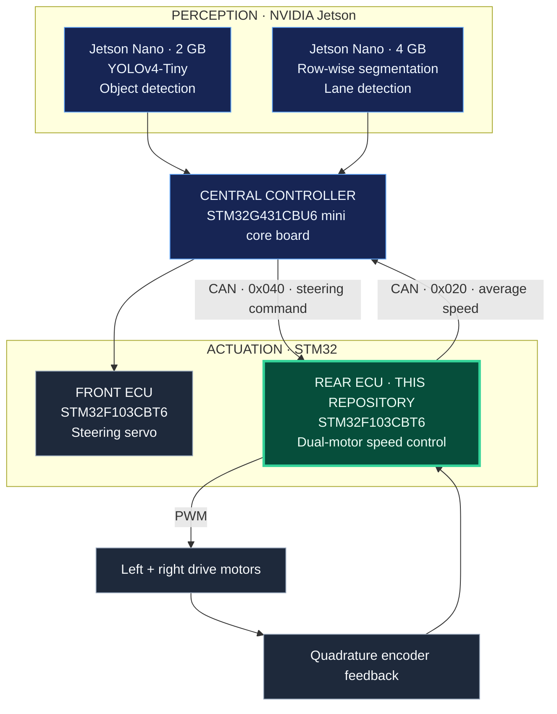
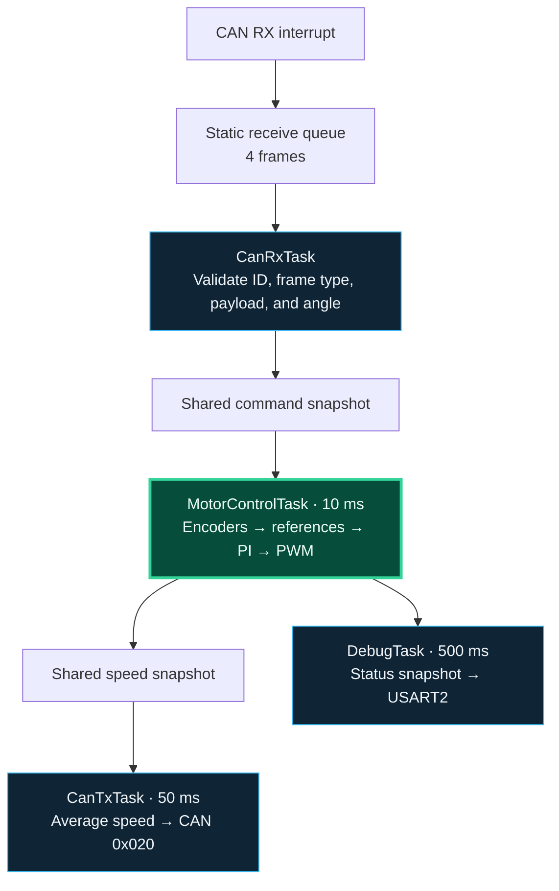
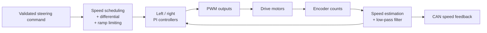

<p align="center">
  
</p>

# 🚗 STM32 Rear-Wheel ECU for an Autonomous Vehicle

A dual-motor rear-wheel controller built with **STM32F103CBT6, FreeRTOS, and CAN**. The ECU turns steering commands into independent wheel-speed targets, closes the loop with quadrature encoders, and reports vehicle-speed feedback to the central controller.

<p align="center">
  
  
  
  
</p>

<p align="center">
  <a href="vid_car.mp4"><strong>▶ Vehicle demo</strong></a> &nbsp; · &nbsp;
  <a href="#my-contribution">My contribution</a> &nbsp; · &nbsp;
  <a href="#system-architecture">Architecture</a> &nbsp; · &nbsp;
  <a href="#research-recognition">Research award</a> &nbsp; · &nbsp;
  <a href="#configuration-and-flashing">Build &amp; run</a>
</p>

<a id="vehicle-demonstration"></a>

<p align="center">
  <a href="vid_car.mp4">
    
  </a>
  <br>
  <sub>The team’s vehicle prototype · Click the photograph to open the MP4 demonstration.</sub>
</p>

<table>
  <tr>
    <th align="center">CONTROL LOOP</th>
    <th align="center">CAN BUS</th>
    <th align="center">SPEED FEEDBACK</th>
    <th align="center">DRIVE CHANNELS</th>
  </tr>
  <tr>
    <td align="center"><strong>100 Hz</strong><br><sub>10 ms motor task</sub></td>
    <td align="center"><strong>500 kbit/s</strong><br><sub>Classic CAN</sub></td>
    <td align="center"><strong>20 Hz</strong><br><sub>50 ms telemetry</sub></td>
    <td align="center"><strong>2 motors</strong><br><sub>Independent PI control</sub></td>
  </tr>
</table>

<p align="center"><sub>Firmware configuration values; measured control performance remains to be characterized.</sub></p>


---

<a id="table-of-contents"></a>

## 📑 Table of Contents

| Explore the project | Work with the firmware |
| --- | --- |
| [Vehicle demonstration](#vehicle-demonstration) | [Hardware & pinout](#hardware-and-pinout) |
| [My contribution](#my-contribution) | [Directory structure](#directory-structure) |
| [System architecture](#system-architecture) | [Prerequisites](#prerequisites) |
| [Key features](#key-features) | [Configuration & flashing](#configuration-and-flashing) |
| [Real-time task design](#real-time-task-design) | [Live diagnostics](#live-diagnostics) |
| [Wheel-speed control](#wheel-speed-control) | [Validation & next steps](#validation-and-next-steps) |
| [CAN protocol](#can-protocol) | [Research recognition](#research-recognition) |

---

<a id="my-contribution"></a>

## 👨‍💻 My Contribution

The team vehicle combines **two NVIDIA Jetson boards and three STM32 controllers** for object detection, lane detection, central coordination, front steering, and rear propulsion.

**Bùi Đoàn Anh Khoa · Rear-wheel ECU**

My responsibility is the rear-wheel controller and its integration with the central vehicle controller. The firmware brings together three areas of embedded engineering:

| Motion control | Real-time firmware | Vehicle communication |
| --- | --- | --- |
| Independent left/right PI loops | FreeRTOS with CMSIS-RTOS2 | Validated CAN steering commands |
| Quadrature encoder speed estimation | Periodic 10 ms motor-control task | Average-speed feedback at 20 Hz |
| Filtering and anti-windup | Separate receive, control, transmit, and debug tasks | Command-freshness monitoring |
| Speed ramps and electronic differential | Static application task and receive-queue storage | UART diagnostic snapshots |

The wider team develops the Jetson perception pipelines, central controller, and steering ECU. This repository focuses on my rear-wheel firmware.

<p align="right"><a href="Core/Src/main.c">Explore the control implementation →</a></p>
---

<a id="system-architecture"></a>

## 🏗 System Architecture

| Vehicle module | Hardware | Role |
| --- | --- | --- |
| Object detection | Jetson Nano **2 GB** | **YOLOv4-Tiny** object detection |
| Lane detection | Jetson Nano **4 GB** | **Row-wise segmentation** for lane detection |
| Central controller | **STM32G431CBU6** mini core board | Central processing and vehicle coordination |
| Front-wheel ECU | STM32F103CBT6 | Front steering-servo control |
| **Rear-wheel ECU · this repository** | **STM32F103CBT6** | **Two drive motors, encoder feedback, and speed regulation** |



<sub>Functional system overview. Jetson communication interfaces are not specified in this diagram.</sub>
---

<a id="key-features"></a>

## ✨ Key Features

1. **Independent wheel-speed control**<br>
   Two encoder-feedback loops regulate the left and right motors. Each has separate PI gains and minimum effective PWM settings to accommodate different drive responses.

2. **Periodic real-time execution**<br>
   A dedicated motor task runs every **10 ms** using `vTaskDelayUntil`. CAN reception, speed transmission, and diagnostic output have separate tasks.

3. **Steering-dependent speed scheduling**<br>
   The base reference ranges from **0.10 to 0.30 m/s**, reducing with steering demand. Acceleration and deceleration limits shape reference changes.

4. **Electronic differential**<br>
   A steering-dependent offset adjusts the left and right wheel targets, with a center deadband and maximum differential ratio of **0.10**.

5. **Filtered feedback and anti-windup**<br>
   Encoder count differences become speed estimates, smoothed by a first-order low-pass filter. Integral clamping and conditional integration limit controller windup.

6. **CAN integration and command supervision**<br>
   The ECU validates steering commands and publishes average speed every **50 ms**. Timeout and bus-off handling paths are implemented; their open validation findings are documented [below](#validation-and-next-steps).

---

<a id="real-time-task-design"></a>

## ⚙️ Real-Time Task Design

The CAN receive interrupt copies raw frames into a **four-entry queue**. Parsing occurs in task context; the motor-control task owns the encoder, controller, and PWM updates.



| Task / function | Trigger | CMSIS-RTOS2 priority | Responsibility |
| --- | --- | --- | --- |
| `CanRxTask` | Receive queue; waits when empty | High | Parse and validate commands; update shared state |
| `MotorControlTask` | Every 10 ms | Realtime | Read encoders, check command state, update references and motor outputs |
| `CanTxTask` | Every 50 ms | Normal | Send average rear-wheel speed |
| `DebugTask` | Every 500 ms | Low | Format and transmit a UART status snapshot |

Application task stacks, control blocks, and receive-queue storage use static allocation. Dynamic allocation is not disabled throughout the RTOS configuration.

---

<a id="wheel-speed-control"></a>

## 🎛 Wheel-Speed Control

Each control cycle estimates both wheel speeds, filters the measurements, derives the wheel references, and updates motor PWM.



### Encoder-to-speed conversion

With the configured wheel diameter `D = 0.065 m`, encoder resolution `N = 1560 counts/revolution`, and sample interval `Ts = 0.010 s`:

```text
wheel_speed = encoder_count_change × (π × D) / (N × Ts)

filtered_speed[k] = 0.30 × wheel_speed[k]
                  + 0.70 × filtered_speed[k−1]

average_rear_speed = (filtered_left_speed + filtered_right_speed) / 2
```

### Current tuning and timing

| Parameter | Configured value / implementation |
| --- | --- |
| Motor-control period | 10 ms / 100 Hz, using `vTaskDelayUntil` |
| Encoder resolution | 1,560 counts per wheel revolution |
| Wheel diameter | 65 mm |
| Speed low-pass filter | First order, α = 0.30 |
| Left controller gains | Kp = 150, Ki = 40, Kd = 0 |
| Right controller gains | Kp = 180, Ki = 55, Kd = 0 |
| Anti-windup | Integral clamping and conditional integration |
| Base speed range | 0.10–0.30 m/s while a valid command is active |
| Acceleration / deceleration limits | 2.0 / 4.0 m/s² |
| Differential | Maximum ratio 0.10, with a center deadband |
| Command freshness limit | 200 ms; intended response is ramp-down followed by zero PWM |
| CAN feedback period | 50 ms / 20 Hz |
| UART diagnostic period | 500 ms / 2 Hz |

The controller structures support PID; the current gains give **PI control** because both derivative gains are zero. The electronic differential uses a simple steering-based offset.

The differential uses a simple steering-dependent offset rather than a geometry-based Ackermann calculation. These constants describe the configured model and tuning, not measured tracking performance.

---

<a id="can-protocol"></a>

## 📡 CAN Protocol

**Classic CAN · 500 kbit/s · standard 11-bit IDs · little-endian**

Directions are relative to the rear ECU.

| Direction | CAN ID | Payload | Scaling | Schedule |
| --- | --- | --- | --- | --- |
| RX from VCU | `0x040` | Signed 16-bit target steering angle | 0.01° per unit | Keep fresh within 200 ms |
| TX to VCU | `0x020` | Signed 16-bit average rear-wheel speed | 1 mm/s per unit | Every 50 ms |

The documented payload length is **2 bytes**. The current receiver accepts at least two bytes and checks the frame and angle before updating the command. Steering center is **90°**, with an accepted range of **50–130°**.

| Example | Integer representation | Payload bytes |
| --- | --- | --- |
| Steering command: 90° | 9000 centi-degrees | `28 23` |
| Speed feedback: 0.25 m/s | 250 mm/s | `FA 00` |

For example, a standard data frame with ID `0x040`, DLC `2`, and payload `28 23` commands the **90° steering center**. The command must be refreshed within the configured freshness window to request continued drive operation. Resolve the timebase finding before relying on timeout behavior.

---

<a id="hardware-and-pinout"></a>

## 🔌 Hardware & Pinout

Required for rear-wheel ECU integration: an STM32F103CBT6 board, two encoder-equipped drive motors, a suitable motor driver, a CAN transceiver, and an ST-LINK programmer.

| Function | Peripheral | MCU pins |
| --- | --- | --- |
| Encoder input pair 1 | TIM2 CH1 / CH2 | PA0 / PA1 |
| Encoder input pair 2 | TIM3 CH1 / CH2 | PA6 / PA7 |
| Motor PWM outputs | TIM4 CH1–CH4 | PB6 / PB7 / PB8 / PB9 |
| CAN RX / TX | CAN1 | PA11 / PA12 |
| Debug TX / RX | USART2 | PA2 / PA3 |

UART: **115200 baud · 8 data bits · no parity · 1 stop bit**.

CAN uses an external transceiver and a terminated bus. PWM outputs connect through a suitable motor driver. The driver model and complete vehicle wiring have yet to be documented.
---

<a id="directory-structure"></a>

## 📁 Directory Structure

```text
stm32-rear-wheel-ecu/
├── Core/
│   ├── Inc/
│   │   ├── FreeRTOSConfig.h          # RTOS configuration
│   │   └── main.h                   # Application declarations
│   └── Src/
│       ├── main.c                   # Control, CAN, application tasks, initialization
│       ├── stm32f1xx_hal_msp.c       # Peripheral GPIO, clocks, and NVIC setup
│       └── stm32f1xx_it.c            # Interrupt handlers
├── Drivers/                         # STM32 HAL and CMSIS dependencies
├── Middlewares/                     # FreeRTOS dependencies
├── docs/assets/                     # README banner
├── scientific-cert/                 # Team certificate and award photograph
├── encoder_reading.ioc              # STM32CubeMX configuration
├── STM32F103CBTX_FLASH.ld            # Linker memory layout
├── car-cleaned-upscaled.png          # Presentation photograph
├── car1.jpg                         # Original vehicle photograph
├── vid_car.mp4                      # Vehicle demonstration
└── README.md
```

Start with [`Core/Src/main.c`](Core/Src/main.c) to follow the application. The CubeIDE project files and settings are also included; generated build output is ignored.

---

<a id="prerequisites"></a>

## 📦 Prerequisites

| Tool / component | Purpose |
| --- | --- |
| STM32CubeIDE | Import, build, and debug the firmware |
| ST-LINK and SWD connection | Program the STM32 and inspect execution |
| Serial terminal + compatible UART adapter | Read USART2 diagnostics |
| VCU or CAN test interface | Supply steering commands and inspect speed feedback |

The previous recorded build used **STM32CubeIDE 1.18.0** and **GNU Tools for STM32 13.3.rel1**. HAL, CMSIS, and FreeRTOS sources are included in the repository.

---

<a id="configuration-and-flashing"></a>

## 🚀 Configuration & Flashing

### 1. Import and inspect

In STM32CubeIDE, choose **File → Import → General → Existing Projects into Workspace**, then select this folder. The imported project is named **`encoder_reading`**.

Review the pin mapping above and the mechanical constants, encoder signs, PI gains, and PWM thresholds in [`main.c`](Core/Src/main.c) against your actual hardware.

### 2. Build the firmware

Select the **Debug** configuration and use **Project → Build Project**. The IDE generates the build output locally.

### 3. Program the controller

Connect ST-LINK to **SWDIO, SWCLK, and GND**, with the target power/reference connection appropriate to the programmer and board. Confirm the board pinout, then launch the CubeIDE debug configuration to program the MCU.

### 4. Bring up the rear-wheel ECU

1. Lift the drive wheels and verify encoder polarity and motor-driver mapping.
2. Open USART2 diagnostics at **115200 baud, 8N1**.
3. Connect the CAN transceiver to the terminated vehicle/test bus at **500 kbit/s**.
4. Supply valid steering commands on `0x040` and inspect speed feedback on `0x020`.
5. After resolving the open firmware findings, verify command loss, recovery, and bus-off behavior before a vehicle test.

The original project name is retained to keep the existing CubeIDE metadata consistent.

---

<a id="live-diagnostics"></a>

## 📊 Live Diagnostics

The low-priority debug task prints a status snapshot every **500 ms** through USART2.

### Example output

The following values illustrate the firmware’s output format; they are not captured test results.

```text
A=90.0 V=0.30 L=0.29 R=0.30 P=24/35
```

| Field | Meaning | Unit |
| --- | --- | --- |
| `A` | Latest steering angle in the shared command state | Degrees |
| `V` | Base speed reference after ramp limiting | m/s |
| `L` / `R` | Filtered left / right wheel speeds | m/s |
| `P` | Left / right motor commands | % |

The debug task uses a blocking UART transmit in its own task context. The status line shows the control snapshot; inspect command freshness and CAN fault counters separately when debugging communication faults.

---

<a id="validation-and-next-steps"></a>

## 🧪 Validation & Next Steps

**Current stage: research prototype with documented source-review findings.** A previous forced Debug rebuild completed without compiler warnings or errors in the captured log. That build was not repeated for this README update. Runtime stack/heap margins and this exact firmware revision’s behavior on hardware remain unverified.

| Open item | Work remaining |
| --- | --- |
| CAN interrupt configuration | TX and SCE handlers exist; MSP enables only RX0 NVIC. Enable the missing interrupts with RTOS-compatible priorities and retain the settings through Cube regeneration. |
| Command timeout timebase | Reception uses `HAL_GetTick()`; motor-task freshness checks use `osKernelGetTickCount()`. Use one clock and verify timeout/recovery behavior. |
| Hardware characterization | Confirm encoder polarity, measure wheel-speed tracking, and record command-loss/recovery behavior. |

---

<a id="research-recognition"></a>

## 🏅 Research Recognition

> **🏅 Second Prize · Student Scientific Research Conference 2025–2026**
>
> Electronics and Telecommunications section<br>
> **The University of Danang — University of Science and Technology**

The team certificate, dated **19 May 2026**, names **Bùi Đoàn Anh Khoa** among the award recipients.

<table>
  <tr>
    <th>Team certificate</th>
    <th>Research award</th>
  </tr>
  <tr>
    <td width="50%" align="center">
      <a href="scientific-cert/824f93b3739ff3c1aa8e5.jpg">
        
      </a>
    </td>
    <td width="50%" align="center">
      <a href="scientific-cert/c7cbd737371bb745ee0a4.jpg">
        
      </a>
    </td>
  </tr>
</table>

<details>
<summary><strong>Original vehicle photograph and media notes</strong></summary>

<p align="center">
  
</p>

The cover photograph is an AI-cleaned and enlarged presentation version of this original image. The supplied [vehicle demonstration (MP4)](vid_car.mp4) documents the team prototype; it does not establish control accuracy or validate this exact firmware revision.

</details>
---

<p align="center">
  <strong>Bùi Đoàn Anh Khoa</strong><br>
  <sub>Rear-wheel ECU · Embedded C · Real-time control · Vehicle networks</sub><br><br>
  <a href="#my-contribution">Contribution</a> &nbsp; / &nbsp;
  <a href="Core/Src/main.c">Firmware</a> &nbsp; / &nbsp;
  <a href="vid_car.mp4">Vehicle demo</a>
</p>
