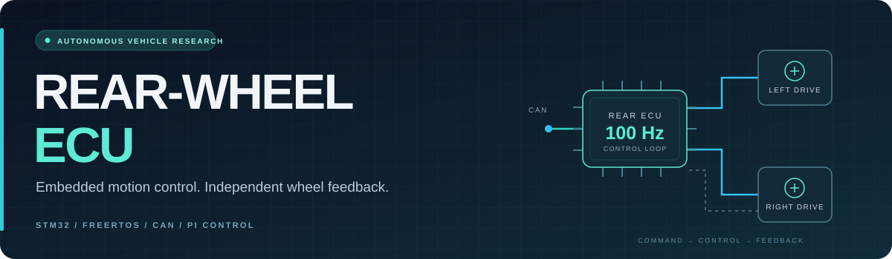
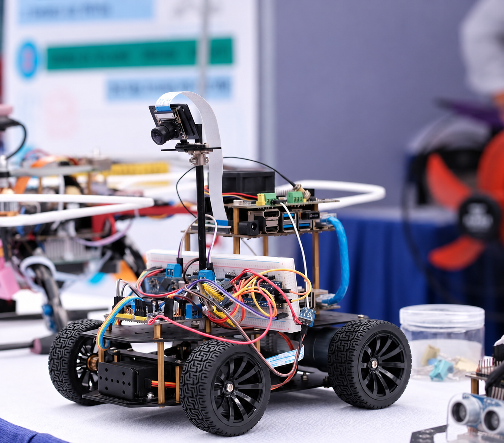
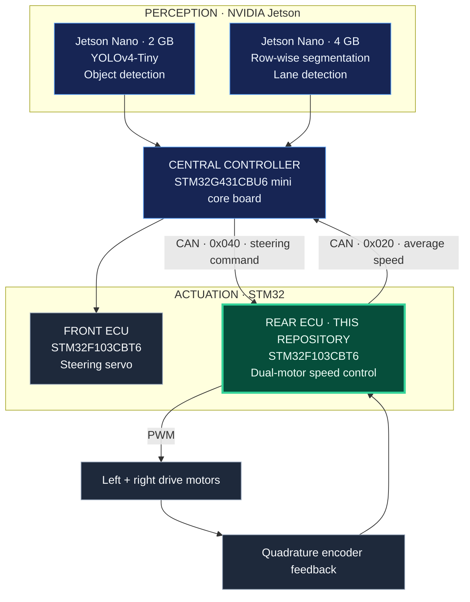
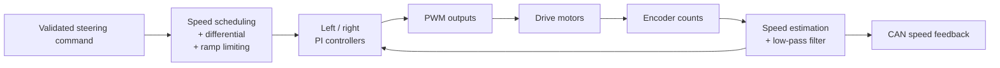
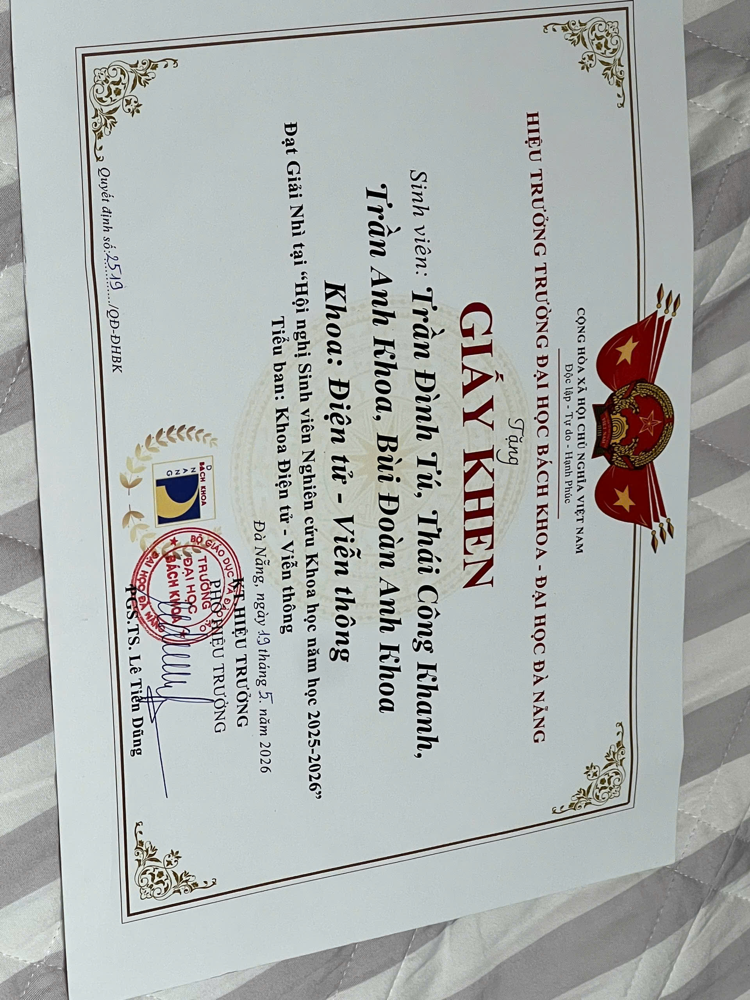
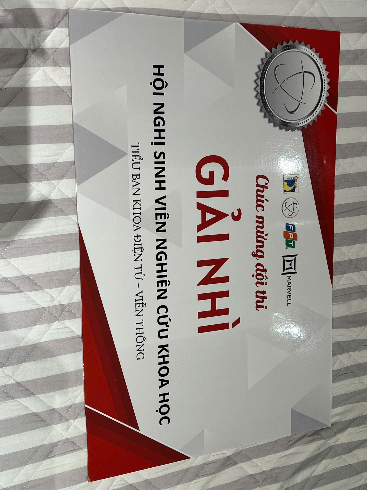
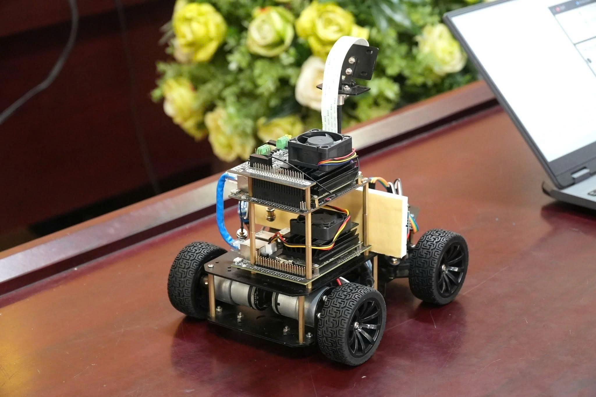

  

  <strong>Two motors. Independent feedback. One coordinated drive system.</strong> 
  STM32 firmware connecting vehicle-level commands to rear-wheel motion.

  
  
  
  

  <a href="vid_car.mp4"><strong>▶ Vehicle demo</strong></a> &nbsp; · &nbsp;
  <a href="#my-contribution">My contribution</a> &nbsp; · &nbsp;
  <a href="#system-architecture">Architecture</a> &nbsp; · &nbsp;
  <a href="#research-recognition">Research award</a> &nbsp; · &nbsp;
  <a href="#build-and-run">Build &amp; run</a>

  
   
  The team’s vehicle prototype · Click the photograph to open the MP4 demonstration.

<table>
  <tr>
    <th align="center">CONTROL LOOP</th>
    <th align="center">CAN BUS</th>
    <th align="center">SPEED FEEDBACK</th>
    <th align="center">DRIVE CHANNELS</th>
  </tr>
  <tr>
    <td align="center"><strong>100 Hz</strong> 10 ms motor task</td>
    <td align="center"><strong>500 kbit/s</strong> Classic CAN</td>
    <td align="center"><strong>20 Hz</strong> 50 ms telemetry</td>
    <td align="center"><strong>2 motors</strong> Independent PI control</td>
  </tr>
</table>

Firmware configuration values; measured control performance remains to be characterized.

## From perception to motion

An autonomous vehicle needs a path from what its cameras see to how its wheels move. Our student research platform distributes that work across **two NVIDIA Jetson boards and three STM32 controllers**: object detection, lane detection, central coordination, front steering, and rear propulsion.

This repository contains the **rear-wheel ECU**. It receives steering commands over CAN, derives separate left and right wheel-speed targets, and uses quadrature encoder feedback to regulate both drive motors. Average rear-wheel speed returns to the central controller over the same bus.

## My contribution

**Bùi Đoàn Anh Khoa · Rear-wheel ECU**

My responsibility is the rear-wheel controller and its integration with the central vehicle controller. The firmware brings together three areas of embedded engineering:

| Motion control | Real-time firmware | Vehicle communication |
| --- | --- | --- |
| Independent left/right PI loops | FreeRTOS with CMSIS-RTOS2 | Validated CAN steering commands |
| Quadrature encoder speed estimation | Periodic 10 ms motor-control task | Average-speed feedback at 20 Hz |
| Filtering and anti-windup | Separate receive, control, transmit, and debug tasks | Command-freshness monitoring |
| Speed ramps and electronic differential | Static application task and receive-queue storage | UART diagnostic snapshots |

The wider team develops the Jetson perception pipelines, central controller, and steering ECU. This repository focuses on my rear-wheel firmware.

<a href="Core/Src/main.c">Explore the control implementation →</a>

## System architecture

Functional system overview. Jetson communication interfaces are not specified in this diagram.

## Inside the rear-wheel ECU

The control path combines steering-dependent speed targets with independent wheel feedback:

- **Independent wheel regulation.** Each motor has its own controller and minimum effective PWM setting to accommodate different drive responses.
- **Steering-aware speed targets.** Base speed is reduced with steering demand; a simple electronic differential offsets the left and right targets during turns.
- **Smoother references and feedback.** Acceleration/deceleration limiting shapes speed changes, while a first-order filter reduces encoder speed noise.
- **Communication supervision.** The firmware validates incoming commands and contains timeout and bus-off handling paths. The timeout and interrupt findings below still need resolution and hardware verification.

<strong>Control parameters and task timing</strong>

| Parameter | Configured value / implementation |
| --- | --- |
| Motor-control period | 10 ms / 100 Hz, using `vTaskDelayUntil` |
| Encoder resolution | 1,560 counts per wheel revolution |
| Wheel diameter | 65 mm |
| Speed low-pass filter | First order, α = 0.30 |
| Left controller gains | Kp = 150, Ki = 40, Kd = 0 |
| Right controller gains | Kp = 180, Ki = 55, Kd = 0 |
| Anti-windup | Integral clamping and conditional integration |
| Base speed range | 0.10–0.30 m/s while a valid command is active |
| Acceleration / deceleration limits | 2.0 / 4.0 m/s² |
| Differential | Maximum ratio 0.10, with a center deadband |
| Command freshness limit | 200 ms; intended response is ramp-down followed by zero PWM |
| CAN feedback period | 50 ms / 20 Hz |
| UART diagnostic period | 500 ms / 2 Hz |

The controller structures support PID; the current gains give **PI control** because both derivative gains are zero. The electronic differential uses a simple steering-based offset. Application task and queue storage are static; this does not imply that dynamic allocation is disabled throughout FreeRTOS.

<strong>CAN interface and payload examples</strong>

**Classic CAN · 500 kbit/s · standard 11-bit IDs · little-endian**

Directions are relative to the rear ECU.

| Direction | CAN ID | Payload | Scaling | Schedule |
| --- | --- | --- | --- | --- |
| RX from VCU | `0x040` | Signed 16-bit target steering angle | 0.01° per unit | Keep fresh within 200 ms |
| TX to VCU | `0x020` | Signed 16-bit average rear-wheel speed | 1 mm/s per unit | Every 50 ms |

The documented payload length is **2 bytes**. The current receiver accepts at least two bytes and checks the frame and angle before updating the command. Steering center is **90°**, with an accepted range of **50–130°**.

| Example | Integer representation | Payload bytes |
| --- | --- | --- |
| Steering command: 90° | 9000 centi-degrees | `28 23` |
| Speed feedback: 0.25 m/s | 250 mm/s | `FA 00` |

<strong>MCU pin mapping and physical interfaces</strong>

| Function | Peripheral | MCU pins |
| --- | --- | --- |
| Encoder input pair 1 | TIM2 CH1 / CH2 | PA0 / PA1 |
| Encoder input pair 2 | TIM3 CH1 / CH2 | PA6 / PA7 |
| Motor PWM outputs | TIM4 CH1–CH4 | PB6 / PB7 / PB8 / PB9 |
| CAN RX / TX | CAN1 | PA11 / PA12 |
| Debug TX / RX | USART2 | PA2 / PA3 |

UART: **115200 baud · 8 data bits · no parity · 1 stop bit**.

CAN uses an external transceiver and a terminated bus. PWM outputs connect through a suitable motor driver. The driver model and complete vehicle wiring have yet to be documented.

## Research recognition

> **🏅 Second Prize · Student Scientific Research Conference 2025–2026**
>
> Electronics and Telecommunications section 
> **The University of Danang — University of Science and Technology**

The team certificate, dated **19 May 2026**, names **Bùi Đoàn Anh Khoa** among the award recipients.

<table>
  <tr>
    <th>Team certificate</th>
    <th>Research award</th>
  </tr>
  <tr>
    <td width="50%" align="center">
      
    </td>
    <td width="50%" align="center">
      
    </td>
  </tr>
</table>

<strong>Original vehicle photograph and media notes</strong>

  

The cover photograph is an AI-cleaned and enlarged presentation version of this original image. The supplied [vehicle demonstration (MP4)](vid_car.mp4) documents the team prototype; it does not establish control accuracy or validate this exact firmware revision.

## Build and run

**Tools:** STM32CubeIDE, an ST-LINK programmer, and the rear ECU hardware. The previously recorded build used **CubeIDE 1.18.0** and **GNU Tools for STM32 13.3.rel1**.

1. **Import** this folder through **File → Import → General → Existing Projects into Workspace**.
2. **Build** the `encoder_reading` project in its **Debug** configuration.
3. **Connect** ST-LINK to the board’s SWD interface and ground; confirm target power and the board pinout.
4. **Program** the MCU using the CubeIDE debug configuration.
5. **Check** encoder direction, motor-driver mapping, CAN traffic, and command-loss/recovery behavior with the wheels lifted before a vehicle test.

<strong>Repository map</strong>

| Path | Purpose |
| --- | --- |
| [Core/Src/main.c](Core/Src/main.c) | Control logic, application tasks, and peripheral initialization |
| [Core/Inc/FreeRTOSConfig.h](Core/Inc/FreeRTOSConfig.h) | RTOS configuration |
| [Core/Src/stm32f1xx_hal_msp.c](Core/Src/stm32f1xx_hal_msp.c) | Peripheral clocks, GPIO, and interrupt setup |
| [Core/Src/stm32f1xx_it.c](Core/Src/stm32f1xx_it.c) | Interrupt handlers |
| [Drivers/](Drivers/) | STM32 HAL and CMSIS dependencies |
| [Middlewares/](Middlewares/) | FreeRTOS dependencies |
| [encoder_reading.ioc](encoder_reading.ioc) | STM32CubeMX configuration |
| [STM32F103CBTX_FLASH.ld](STM32F103CBTX_FLASH.ld) | Linker memory layout |
| [docs/assets/](docs/assets/) | README artwork |
| [scientific-cert/](scientific-cert/) | Certificate and award images |
| [vid_car.mp4](vid_car.mp4) | Vehicle demonstration |

The original CubeIDE project name, `encoder_reading`, is retained for compatibility with the existing project metadata.

## Engineering status

**Current stage: research prototype with documented source-review findings.** A previous forced Debug rebuild completed without compiler warnings or errors in the captured log. That build was not repeated for this README update. Runtime stack/heap margins and this exact firmware revision’s behavior on hardware remain unverified.

| Open item | Work remaining |
| --- | --- |
| CAN interrupt configuration | TX and SCE handlers exist; MSP enables only RX0 NVIC. Enable the missing interrupts with RTOS-compatible priorities and retain the settings through Cube regeneration. |
| Command timeout timebase | Reception uses `HAL_GetTick()`; motor-task freshness checks use `osKernelGetTickCount()`. Use one clock and verify timeout/recovery behavior. |
| Hardware characterization | Confirm encoder polarity, measure wheel-speed tracking, and record command-loss/recovery behavior. |

---

  <strong>Bùi Đoàn Anh Khoa</strong> 
  Rear-wheel ECU · Embedded C · Real-time control · Vehicle networks  
  <a href="#my-contribution">Contribution</a> &nbsp; / &nbsp;
  <a href="Core/Src/main.c">Firmware</a> &nbsp; / &nbsp;
  <a href="vid_car.mp4">Vehicle demo</a>

